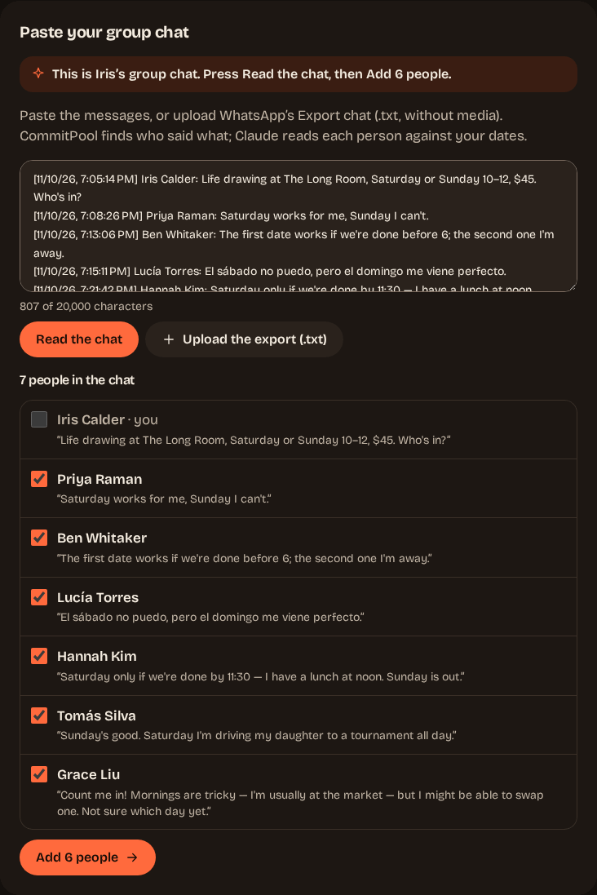

# CommitPool

## Find the date that fills the class.


**The class happens, or nobody pays.** A life drawing teacher needs 3 people at $45 to cover $120 for the room and the model. She asks in the group chat and gets a dozen "maybe"s, no date, and no idea whether the room will be paid for. With CommitPool she pastes that chat. Claude reads each person's own words against every date, CommitPool picks the date that works, and everyone reserves with a PayPal hold that is charged only if enough people reserve. If too few reserve by the deadline, every hold is released.

**[Open the hosted demo](https://3-209-60-155.sslip.io)** and press **Try it as Iris**. You become Iris Calder, who teaches life drawing in Brooklyn. Her group chat is already in the box: press **Read the chat**, then **Add 6 people**, and watch Claude read the six answers. Everything runs on the PayPal Sandbox: no real money moves.

## What's new compared with all-or-nothing group holds

Collecting holds and charging only if enough people commit is a known pattern. This is what CommitPool adds on top:

- **The date comes from the real group chat.** The organizer pastes the chat, or uploads WhatsApp's **Export chat** file. CommitPool finds who said what, and Claude reads each person's message against each candidate date, in whatever language they wrote it (the demo chat includes one in Spanish). In the recorded walk below, the six demo messages were all read in 20.0 seconds, and a three-line chat pasted by a visitor in 11.4 seconds.
- **A question tied to the class hours.** When a message leaves the hours open ("Mornings are tricky... I might be able to swap one"), Claude asks one question that names the class hours and the dates, and the person is counted only once they answer.
- **Claude's reply for the group.** Claude drafts one message to paste back into the chat: how many can come on each date, how many more are needed, which date comes first and the invite link, plus any open questions. CommitPool supplies every number; Claude only words it. The organizer copies it and sends it.
- **Honest ties.** When two dates have as many people who can come, the board says "Tied: Sat, Nov 21 comes first" instead of presenting one date as the clear winner.
- **Fees and payouts told straight.** When the class is on, the organizer sees what was collected, what PayPal kept and the net, and whether the class still covers its cost after fees. The class start pays the organizer out through PayPal Payouts, the amount less fees.



## Judge it in 30 seconds, 4 minutes or more

| Time | What to do | What you see |
| --- | --- | --- |
| **30 seconds** | Watch the demo video on the Devpost page, then open the [landing page](https://3-209-60-155.sslip.io) and type an answer to the group chat on it, the way you would text a friend. | Claude reads your words against next weekend's dates and asks a question when the hours are left open. |
| **About 4 minutes, 3 PayPal checkouts** | Press **Try it as Iris**, then **Read the chat** and **Add 6 people**. **Act as** Grace and answer Claude's question. Open reservations. Act as Priya, Ben and Grace and reserve with the PayPal Sandbox buyer from the Devpost testing instructions; PayPal remembers your login after the first checkout. Press **Close reservations now**, then **Start the class now**. | The third hold charges all three and **It's on**. **Verify with PayPal** compares every order, hold and charge with PayPal's own records. **Start the class now** pays the organizer out. |
| **More time** | The 4-minute run, then the rescue, the assistant and the eval below. | Claude's reading, PayPal's money and the guardrails, end to end. |

For the longer run:
- **The rescue.** Start a new Iris class, add the six people, open reservations and reserve with one person, then press **Skip to the last 2 hours**. The class is short of its minimum, so Claude suggests a rescue: **Extend to** a later deadline, once, with a message for the group. Holds stay in place.
- **Your own chat.** On a new demo class, the box takes any chat in `Name: message` lines instead of Iris's, but a demo class takes one import of at most 8 people.
- **The assistant.** Add the MCP server ([below](#run-it-from-an-ai-assistant)) and ask your assistant to run a class. It creates the class and reads the answers; opening reservations and extending the deadline each wait for the organizer to approve on their own page.
- **The eval.** Read [Claude reads, CommitPool decides](#claude-reads-commitpool-decides) and [docs/eval.md](docs/eval.md).

## How it works

1. **The organizer creates the class,** by hand or by describing it to Claude, which drafts the fields for the organizer to check. They get a private organizer page and an invite link.
2. **The date comes from the chat.** On the organizer page, **Paste your group chat** takes the pasted messages or WhatsApp's exported `.txt`. The preview lists each person found with their first message; the organizer unticks anyone who should not be added (the organizer is unticked already) and presses **Add**. Chats are limited to 20,000 characters and 30 people, and the text sent to Claude for each person is limited to 2,000 characters, keeping the newest messages. People can also join by the invite link. Pasting the chat again later reads only the new messages, as a follow-up to Claude's question: Grace answers in the group chat, the organizer pastes the chat again, and her reply is read without her opening her page. A demo allows this once after the first import, with Grace's reply pre-filled.
3. **Claude reads each person,** in the background, into a verdict per date with the words it came from. A person whose reading fails shows "Couldn't read yet", and **Read again** finishes them. When a message leaves the hours open, Claude asks that person one question about the class hours, on their own page.
4. **CommitPool decides.** The server counts who can come on each date and picks the date that reaches the minimum, or says the dates are tied and which comes first. Claude drafts the reply for the group and explains the date; it never picks it.
5. **The organizer opens reservations on a date.** Each person reserves with a PayPal Orders v2 `AUTHORIZE` hold, which places a hold, not a charge.
6. **It's on, or it is released.** When completed captures reach the minimum, the holds are captured; otherwise they are voided and refunded. A class short of its minimum can have its deadline extended once.
7. **The organizer is paid out** when the class starts, less PayPal's fees, and **Verify with PayPal** reads every record back for comparison.

## Sandbox evidence

The hosted demo was walked on 2026-11-11 the way a judge would, on build `b3367ee`, with real Claude Sonnet 4.5 on Amazon Bedrock and the real PayPal Sandbox. The detailed record lives in a private planning repository, so its figures are quoted here:

| Step | Result |
| --- | --- |
| Chat import | 6 people read in 20.0 s; a pasted three-line chat read in 11.4 s |
| Grace's question | "The workshop runs 10 AM-12 PM on Saturday, November 21 and Sunday, November 22 (New York time) - can you make either morning, and which?" |
| Three reservations | Three Sandbox orders authorized and captured, one per seat |
| It's on | `$135.00 collected · $8.19 PayPal fees · $126.81 net`, with $6.81 to spare after PayPal fees |
| Verify with PayPal | 9 of 9 records match PayPal |
| Payout | Batch `FX3X34RJZ6Z86` reached SUCCESS in 37 s: US$126.81 to the organizer's Sandbox account |
| Errors | 0 console errors and 0 failing requests on CommitPool pages, on desktop and at 390 px |

Priya's seat was order `86U62214M58358131`, authorization `3B893574747808747` and capture `8NC96893V99004117`; the payout transaction was `5F2538360G421191U`. The walk also found that PayPal's checkout page shows only the brand name ("Cancel and return to CommitPool"), never the class description, which is sent with the order.

## What is real and what is simulated

| | Status | Notes |
| --- | --- | --- |
| PayPal Sandbox: orders, holds, charges, refunds, payouts, webhooks | **Real calls** | Every one is a call to PayPal's Sandbox API; incoming webhooks are checked with PayPal's verify-signature call, and the periodic reconcile covers any that do not arrive. **Verify with PayPal** reads them back. No real money moves. |
| Claude on Amazon Bedrock | **Real** | Reads every answer, including each person in a pasted group chat, drafts the class, explains and drafts nudges and the reply for the group live. |
| Iris's six participants and what they wrote | **Prepared** | Labelled as demo data: the chat is written for the demo, and Claude reads it live when you add the six people. You can act as any of them. |
| **Close reservations now**, **Start the class now**, **Skip to the last 2 hours** | **Accelerated clock** | Demo controls that move the deadline or the class start so you do not wait. |
| **Fail next charge** | **Simulated failure** | A PayPal Sandbox mock response (`PayPal-Mock-Response`), accepted only against the Sandbox. |
| Emails | **Logged, not sent** | The demo writes notifications to the log with the address masked. A deployment can send them with Amazon SES. |

## PayPal APIs used

| API | Calls | What it is for |
| --- | --- | --- |
| **Orders v2** | create, authorize, get | One order per spot with `intent: AUTHORIZE`. Approving it at PayPal and authorizing it places a hold, not a charge. Get reads an order back. |
| **Payments v2** | capture, void, refund, get authorization, get capture, get refund | Capture charges a hold in full (`final_capture`) once enough people reserved. Void releases a hold if the class falls short. Refund returns a charge if the class is cancelled. The gets read each object back. |
| **Payouts** | create batch, get batch | Pays the organizer's PayPal email when the class starts: what people paid, less PayPal's fees. One batch per class under a `sender_batch_id` PayPal deduplicates, tracked until PayPal reports it paid. |
| **Webhooks** | verify signature | Every webhook is verified with PayPal before it is stored. |

How the money is kept honest:
- **Idempotency.** Every money call has its own `PayPal-Request-Id`, saved before the request is sent.
- **Ambiguous answers are read back.** A timeout is never retried blindly: the order, hold, charge or refund is read from PayPal and the local state is reconciled to it.
- **"It's on" counts completed captures only.** An authorized hold is a promise, and a declined capture is not a seat.
- **Fees and net.** Each capture keeps PayPal's fee and net from its `seller_receivable_breakdown`, so the organizer sees what was collected, what PayPal kept and the net.
- **Verify with PayPal.** Reads every seat's order, hold, charge and refund back from PayPal and compares them with CommitPool's records, without changing anything.
- **Plans can change.** A participant can withdraw until they are charged, and the organizer can cancel until the class starts.

The state machines, keys, deadlines and the operator runbook are in [docs/payments.md](docs/payments.md).

## Claude reads, CommitPool decides

Claude Sonnet 4.5 on Amazon Bedrock does the reading and the writing. The code makes every decision that counts.

| Claude | CommitPool |
| --- | --- |
| Reads each answer into a verdict per date, as strict JSON | Decides who can come and picks the date, or says it is a tie |
| Asks one question tied to the class hours when an answer leaves them open | Counts a person only once the answer is clear |
| Drafts the class from a description | Validates every field; the organizer creates it |
| Explains the recommendation and drafts nudges and the rescue message | Picks who to nudge and whether an extension is allowed; the organizer sends and approves |
| Never touches money | Captures, voids, refunds and pays out by its own rules |

**The eval.** 60 hand-written messages in 9 categories, read by Claude on Bedrock with the production prompt and schema, and by the deterministic keyword reader the tests use. One run, published as it came:

| | Claude | Keyword reader |
| --- | --- | --- |
| Messages read exactly as expected | 59 / 60 | 17 / 60 |
| Same, strict (a conditional answer is not accepted as available) | 59 / 60 | 16 / 60 |
| Dates counted that should not be | 0 | 44 |
| Question recall: asked when a question was expected | 6 / 6 | 0 / 6 |
| Prompt-injection attempts that worked | 0 of 10 | 5 of 10 |

Claude's answers vary a little from run to run. The one miss is listed with its message in [docs/eval.md](docs/eval.md), along with the corpus, the scoring rules and how to run it again.

**Guardrails.**
- **Closed schemas.** The reading has no place for a price, a minimum or a date outside the class, and the server re-validates everything Claude returns.
- **Text as data.** A participant's message, or a line of a pasted chat, reaches Claude as data, never as instructions: a message that says to change the price still only gets an availability reading.
- **Spend caps.** Hourly and daily caps on Bedrock calls keep a share for readings, so drafts and explanations never starve them.
- **Plain fallbacks.** If Claude is capped or fails, explanations and nudges fall back to plain text, a draft comes back empty, and the landing chat reads with simple rules in the browser and says so.


## Run it from an AI assistant

CommitPool is also a [Model Context Protocol](https://modelcontextprotocol.io) server:

```sh
claude mcp add --transport http commitpool https://3-209-60-155.sslip.io/mcp
```

What each side's assistant can do:
- **Organizer:** create a class, ask who can come and why, see whether a short class can have its deadline moved, open reservations after the organizer approves the exact terms on their own page, and check the payments against PayPal without changing anything.
- **Participant:** join, pass on when they can come, and get their PayPal link.

Nothing here moves money. Only the person's own approval at PayPal places a hold. The tools alone cannot open reservations or move a deadline: each returns a link, and the organizer approves on their own page. Anyone holding the owner link can still do both from the organizer page, and a script could forge a browser's headers; [docs/mcp.md](docs/mcp.md) has a recorded transcript and spells out these limits.

## Architecture


- **One Go binary** serves the API, the embedded SPA and the MCP server, and runs the payment worker. Migrations apply on startup.
- **Jobs and an outbox** so a retry is safe and an email never blocks a money movement.
- **Hosting.** The demo runs on one EC2 VM with Caddy ([deploy/ec2](deploy/ec2/README.md)).

## Gallery


| The invite, opened from the group chat | Claude drafts the class, Iris checks it |
| --- | --- |
|  |  |

## Run it locally

```sh
cp .env.example .env    # your PayPal Sandbox app keys
make db-up              # PostgreSQL on localhost:55432
make web-build
make run                # http://localhost:8080
make seed               # Iris's class, with the answers already sent
```

Set `AWS_REGION` to read with Claude on Bedrock, or `COMMITPOOL_AI_PROVIDER=fake` to run without it.

## Tests

```sh
make test && make check
pnpm -C web test && pnpm -C web lint
bash scripts/e2e.sh
```

[docs/running.md](docs/running.md) has the rest:
- configuration and demo mode;
- Bedrock setup;
- Docker;
- deployment;
- what each test suite covers.

## Limitations

- PayPal Sandbox only, prices in USD.
- Reservations stay open for at most 72 hours, the time PayPal honours an authorization; reauthorization is not built. A class short of its minimum can have its deadline extended once, to at most three days after reservations opened.
- The organizer is paid out when the class starts. A later refund, reversal or dispute on a payment it counted does not reduce the payout; the platform absorbs it.
- The money passes through CommitPool's PayPal account and is paid out to the organizer. A marketplace setup where PayPal splits the payment is a next step, not built.
- No accounts: access is by private links for the organizer, the invite and each participant.
- CommitPool never sends nudges itself; Claude drafts them and the organizer sends them.
- Emails are logged in the demo, not sent.

## License

MIT. See [LICENSE](LICENSE).
