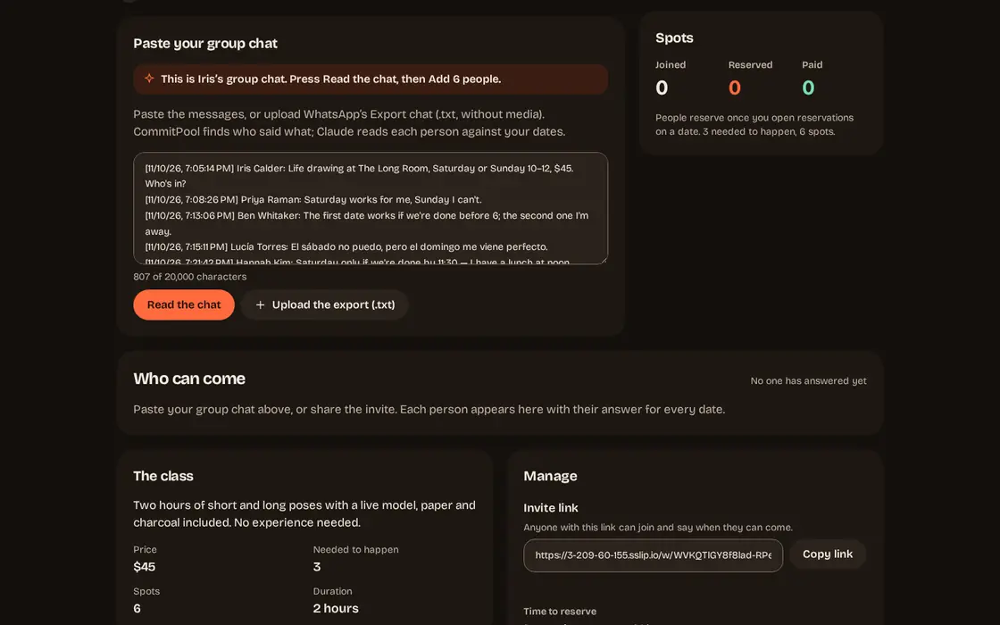
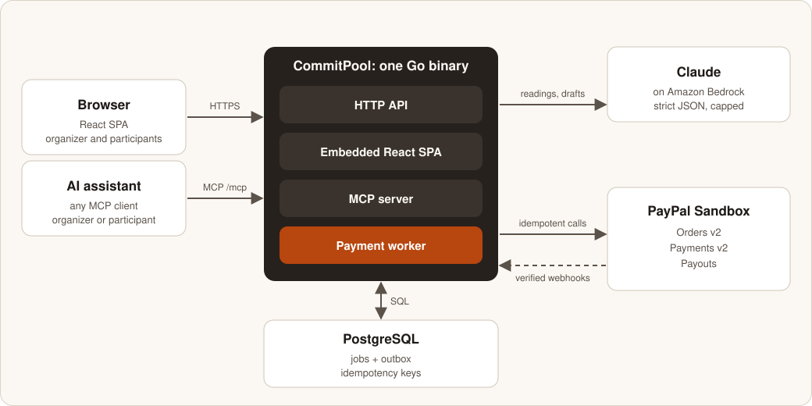
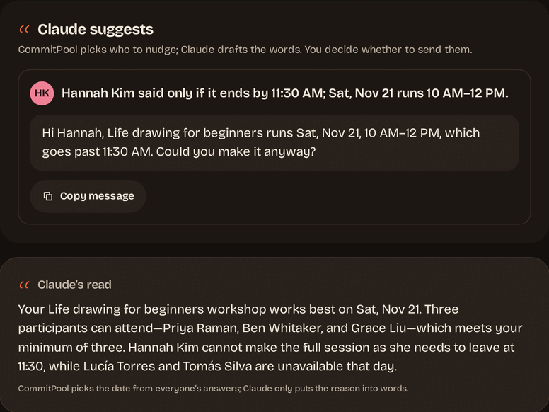

# CommitPool

**Find the date that fills the class.**



**The class happens, or nobody pays.** Iris, the demo's fictional life drawing teacher, needs 3 people at $45 to cover $120 for the room and the model. Her group chat holds a dozen maybes and no date. She pastes it into CommitPool: Claude reads each person against each date, CommitPool picks the date that reaches 3, and everyone reserves with a PayPal hold, charged only once 3 reserve. Otherwise every hold is released.

**[Open the live demo](https://3-209-60-155.sslip.io)** · Video and testing instructions: on the CommitPool Devpost page · PayPal Sandbox: no real money moves.

Why it matters: small free events see a median of about 37% no-shows, small paid ones about 17% ([PheedLoop](https://pheedloop.com/blog/event-data-lab-report-5)).

## What's new compared with all-or-nothing group holds

Charging only if enough people commit is a known pattern. CommitPool adds:

- **The date comes from the real group chat,** pasted or exported from WhatsApp. Claude reads each person in the language they wrote in, and a second paste reads only the new messages.
- **One question tied to the class hours** when a message leaves them open. The person counts only after answering.
- **A reply for the group:** Claude words one message to paste back, with the count per date and the invite link. CommitPool supplies every number.
- **Honest ties:** "Tied: Sat, Nov 21 comes first", not a false winner.
- **Fees told straight:** what was collected, PayPal's fees and the net, which PayPal Payouts sends the organizer when the class starts.

## Judge it in 30 seconds, 4 minutes or more

**30 seconds.** On the [landing page](https://3-209-60-155.sslip.io), answer the group chat as you would text a friend: Claude reads it against next weekend's dates and asks when the hours are open.

**About 4 minutes, 3 PayPal checkouts:**

1. On the demo, press **Try it as Iris**, then **Read the chat** and **Add 6 people**. Saturday and Sunday tie at 2 of the 3 needed, and Claude asks Grace about the class hours.
2. **Paste more of the chat** already holds Grace's reply: press **Read the chat**, then **Read new messages from 1 person**. Saturday reaches 3. (Or **Act as** Grace and answer on her page.)
3. Press **Open reservations** and confirm.
4. Act as Priya, Ben and Grace, and reserve with the Sandbox buyer under **For judges** on the landing (or in the Devpost testing instructions). The third hold charges all three: **It's on**.
5. Press **Verify with PayPal**, **Close reservations now**, then **Start the class now**: "Class started · $126.81 paid out to Iris".

**More time:**
- **The rescue:** press **Try it as Iris** again, add the six people, read Grace's reply, open reservations, reserve as two people, then press **Skip to the last 2 hours**. Claude offers to **Extend to** a later deadline, once.
- **Your own chat** on a new demo class: any `Name: message` lines, up to 8 people.
- **The assistant:** [MCP](#from-an-ai-assistant-mcp) below.

## Real, with evidence

- **Real:** PayPal Sandbox calls (orders, holds, charges, refunds, payouts, webhooks) and Claude Sonnet 4.5 on Amazon Bedrock.
- **Prepared:** Iris's six people and their messages, read live by Claude.
- **Accelerated clock:** **Close reservations now**, **Start the class now**, **Skip to the last 2 hours**.
- **Simulated:** **Fail next charge**, a Sandbox mock response.
- **Logged, not sent:** emails.

The hosted demo, walked as a judge would on 2026-11-11, on the submitted build `58e653e`:

| Step | Result |
| --- | --- |
| Chat import | 6 of 6 people read in 15.9 s, with live progress |
| Pasting the chat again | Only Grace's new message read; Saturday went from 2 to 3 in about 5.4 s |
| It's on | `$135.00 collected · $8.19 PayPal fees · $126.81 net`, $6.81 to spare after fees |
| Verify with PayPal | 9 of 9 records match PayPal |
| Payout | Batch `L8SSKBUKM5UF6` reached SUCCESS 32.8 s after **Close reservations now** |
| Errors | 0 console errors or failing requests on CommitPool pages; no horizontal scroll at 390 px |

Priya's spot: order `7UV14666HK580221P`, authorization `7D4155031A510524L`, capture `0T125042VN752083V`; payout transaction `3VS31946U66412214`.

**The eval:** 60 hand-written messages, read by Claude and by the keyword reader the tests use; one run, published as it came in [docs/eval.md](docs/eval.md).

| | Claude | Keyword reader |
| --- | --- | --- |
| Messages read exactly as expected | 59 / 60 | 17 / 60 |
| Dates counted that should not be | 0 | 44 |
| Asked a question when one was expected | 6 / 6 | 0 / 6 |
| Prompt injections that worked | 0 of 10 | 5 of 10 |

## How it works: Claude reads, CommitPool decides, PayPal moves the money

1. The organizer creates a class; Claude can draft it from a description.
2. She pastes the group chat; plain code splits it by person.
3. Claude reads each person into a verdict per date (can come, maybe, can't, not sure), quoting their words.
4. CommitPool picks the date that reaches the minimum, or calls a tie.
5. Each participant reserves a spot with a PayPal hold.
6. Once the holds reach the minimum they are charged, and the class is on when completed charges reach it. Short at the deadline, every hold is released and any charge refunded.
7. At the class start, PayPal Payouts sends the organizer the net.

| Claude | CommitPool |
| --- | --- |
| Reads each answer into strict JSON | Decides who can come and picks the date |
| Asks one question when the hours are open | Counts a person only once the answer is clear |
| Drafts the class, the reply for the group and nudges (a message to one person) | Validates; the organizer sends and approves |
| Never touches money | Holds, charges, releases, refunds, pays out |

Guardrails (closed schemas, messages read as data, spend caps, plain fallbacks): [docs/running.md](docs/running.md#claude-on-amazon-bedrock).

## PayPal APIs used

| API | Calls | Use |
| --- | --- | --- |
| **Orders v2** | create, authorize, get | One order per spot, `intent: AUTHORIZE`: a hold |
| **Payments v2** | capture, void, refund, get | Charge, release or refund |
| **Payouts** | create batch, get batch | The organizer's net, one `sender_batch_id` per class |
| **Webhooks** | verify signature | A verified event triggers a read-back |

- Every money call has a `PayPal-Request-Id`, saved before it is sent.
- A timeout is never retried blind: PayPal is read back first.
- A participant can leave until charging starts; the organizer can cancel until the class starts.

States, keys and retries: [docs/payments.md](docs/payments.md).

## Architecture



- **One Go binary:** the API, the React app, the MCP server and the payment worker, over PostgreSQL.
- **Jobs and an outbox:** a retry is safe, and an email never blocks a money move.
- **Hosting:** one EC2 VM with Caddy ([deploy/ec2](deploy/ec2/README.md)).

## From an AI assistant (MCP)

```sh
claude mcp add --transport http commitpool https://3-209-60-155.sslip.io/mcp
```

An assistant can create a class, see who can come and get a PayPal link. No tool moves money; opening reservations or extending the deadline waits for the organizer's tap on their own page. See [docs/mcp.md](docs/mcp.md).

## Run it locally

```sh
cp .env.example .env    # your PayPal Sandbox app keys
make db-up && make web-build
make run                # http://localhost:8080
make seed               # Iris's class, with the answers sent
```

Set `AWS_REGION` for Bedrock, or `COMMITPOOL_AI_PROVIDER=fake`. Configuration and tests (979 Go test functions, 3 fuzz targets, 490 vitest tests, 29 Playwright tests): [docs/running.md](docs/running.md).

## Limitations

- PayPal Sandbox and USD only.
- Reservations stay open at most 72 hours, PayPal's hold period; the deadline can be extended once.
- The payout at class start is final: the platform absorbs a later refund or dispute.
- The money passes through CommitPool's PayPal account; a marketplace split is not built.
- One PayPal buyer can reserve several spots.
- No accounts: private links only.

## Docs

[Eval](docs/eval.md) · [MCP](docs/mcp.md) · [Payments](docs/payments.md) · [Design](DESIGN.md) · [Running](docs/running.md)

|  |  |  |
| --- | --- | --- |

## License

MIT. See [LICENSE](LICENSE).
